<p align="center">
  
</p>

<p align="center">
  
  
  
  
  
</p>

<p align="center">
  <a href="#setup">Setup</a> ·
  <a href="#widgets">Widgets</a> ·
  <a href="#live-dashboard">Live dashboard</a> ·
  <a href="#battles">Battles</a> ·
  <a href="#alerts">Alerts</a> ·
  <a href="#going-live">Going live</a> ·
  <a href="#strategy-sim-knobs">Strategy sim</a> ·
  <a href="#calibration-per-regulation-era">Calibration</a> ·
  <a href="#tests">Tests</a>
</p>

**Box Box** is a Formula 1 companion for Windows: desktop widgets (standings, next race countdown, track map, timing tower), a live dashboard that goes live by itself for every session, a strategy simulator for pit stop what-ifs, battle cards and race alerts for the drivers you follow.

> [!TIP]
> No race on? **Replay** any session from 2018 on through the same widgets and dashboard, at up to 60x.

## Setup

Requires Python 3.11+ on Windows.

```
git clone https://github.com/soham2121/box-box.git
cd box-box
python -m venv .venv
.venv\Scripts\pip install -r requirements.txt
.venv\Scripts\python -m boxbox.main
```

After setup, create the **Box Box** desktop shortcut with the F1 icon (it starts the app and opens the live dashboard; double-clicked while the app runs, it just opens the dashboard):

```
powershell -ExecutionPolicy Bypass -File scripts\create_shortcuts.ps1
```

(Run it again if you move the project folder; it also removes the shortcuts of the app's old name, **F1 Live** and **F1 Tracker**.) Without shortcuts: double-click `Box Box.bat`, or run `.venv\Scripts\pythonw.exe run.pyw`.

One app: a tray icon (red **F1**, with a green dot while live), the desktop widgets, one live connection and the live dashboard window. Right-click the icon for everything else; hover it for the status (`LIVE · Race · L35/62 · recording`, or `next: FP1 in 2d 04:10`). Tray → **Start with Windows** makes it start at login (per-user, no admin) with the widgets only (`--tray`); the shortcut or tray → **Open live dashboard** opens the window. Closing the dashboard leaves the tray, widgets and live feed running. Widgets come back where you left them: positions are saved a second after every move or resize. A widget left off every screen (a monitor unplugged or rearranged) moves onto the nearest one.

## Widgets

| Widget | Shows |
|---|---|
| Driver standings | Top N drivers; during a live or replayed race/sprint, the standings if it finished now (F1's own projection feed, so sprint points never count twice) |
| Constructor standings | Top N teams; same projection |
| Next race | Weekend sessions in your local time, countdown to the next one; `FP1 LIVE` (green) while a session runs |
| Track map | Car positions, safety car, SC/VSC/red flag border |
| Timing tower | Position, interval, last lap, tyre + age, stops, pit status |
| Strategy sim | Pit rejoin position, "pit on lap N for compound C" vs current plan, best stop window, "what if it rains / dries from lap N", "what if a safety car / VSC / red flag comes out on lap N" |
| Battles | My drivers against the cars around them, plus pinned pairs (see [Battles](#battles)) |

Drag widgets to move them, use the corner grip to resize. Tray menu: toggle widgets, rows shown, text opacity and background opacity (separately; background 0% still keeps the widget draggable), lock positions, always-on-top vs desktop layer, refresh interval.

On the desktop layer the widgets sit behind your apps but stay visible after **Win+D** / Show desktop, the way Rainmeter does it: when the desktop is in front they're lifted above it. Only one copy runs at a time: launching it again opens the dashboard of the one running.

## Live dashboard

One window for the whole weekend, in a dark theme with F1-style condensed type (Bahnschrift, ships with Windows). No championship standings. The track map with the wind compass is always on the left. The right side changes with the session type (also in replays):

| | Top right | Bottom right |
|---|---|---|
| **Race / sprint** | tabs: **Timing** · **Tyre stints** · **Battles** | tabs: **Strategy sim** · **Race control** |
| **Practice / qualifying** | **sector timing** | **Tyres** and **Race control** side by side |

- **Sector timing:**
  - Best lap and gap to P1.
  - The current lap's S1/S2/S3: mini-sector squares (yellow, green = personal best, purple = overall best, grey = pit lane), and each sector time once done.
  - Last lap, tyre, laps.
  - Qualifying: the header shows Q1/Q2/Q3 (SQ in sprint qualifying) and the time left. Best and gap are for the current part, drop-zone positions are red, knocked-out drivers are greyed.
- **Tyre stints:** each driver's sets as bars in the compound's colour across the race distance, with the laps on that set (`24`, `*` = used set), stops, and the last stop's stationary time (with F1 TV). A car that comes through the pits on the same tyres (red flag) keeps one stint.
- **Tyres:** current compound and its age, new or used, sets used so far.
- **Race control** (scrolls): messages and team radio newest first, with lap, time and flag colour; weather on top. Click **▶ VER radio** to play a clip (again to stop). Each clip gets a transcript underneath, made on your PC by Whisper (`faster-whisper`, `small.en`: ~250 MB downloaded the first time, then about 2 s per clip in the background, newest first). Transcripts are cached in `%APPDATA%\boxbox\radio.json`. Radio is noisy, so expect the odd wrong word.

Tab choices and splitter sizes are remembered. The toolbar's status shows as chips: the feed (green dot while live), session, lap, and the track status in its flag colour (yellow, SC, VSC, red). The timing tower marks the session's fastest lap in purple, and the sim shows its four likeliest finishes as a bar.

Open it with the desktop shortcut or tray → **Open live dashboard**. It shows whatever the app is showing: the live session (the app goes live by itself, see [Going live](#going-live)) or a replay.

Toolbar:
- **● Go live**: connect now, outside the session times too. During a replay it reads **● Back to live** (while a session is live) and stops the replay.
- **Replay**: pick a year (2018–now), then the weekend, then the session; each opens to the side. A year's list loads the first time you open it (a second or two). F1's archive refuses most of 2022, so those files come from FastF1's mirror of the archive (`livetiming-mirror.fastf1.dev`, the same fallback FastF1 uses). Nothing before 2018 exists on either. Some 2018 races (e.g. Australia) have no GPS, so the map shows estimated positions there. 2018 tyres use Pirelli's 2018 range and colours: HS hypersoft pink, US ultrasoft purple, SS supersoft red, S soft yellow, M medium white, H hard ice blue, SH superhard orange. For the sim, a 2018 race's compounds become its softest/middle/hardest (SOFT/MEDIUM/HARD), as the feed names them from 2019. If only two were run they become SOFT/MEDIUM, a guess since the third is unknown.
- **Standings during replays**: the tray's driver and constructor standings show the projection as of that replay (`PROJECTION AS OF 2019 REPLAY`). From mid-2019 that's F1's own projection feed. Before that it's computed from the standings before the session (Jolpica) plus that season's points: race top 10 25–1, +1 for the fastest lap in the top 10 from 2019 to 2024, sprint 3-2-1 in 2021 and 8–1 from 2022.
- **Qualifying in the tray timing tower**: Q1/Q2/Q3 (SQ for sprint qualifying) and time left in the header, best lap of the current part, drop zone in red, knocked-out cars greyed. A second toolbar row then appears: **Pause/Play**, **◀ Lap / Lap ▶** (±1 min outside races), a timeline slider to jump anywhere, the current lap and time, and speed. Jumps take under a second, and the lap history behind them is rebuilt so the sim sees the race as it was at that point. Tray replays have **Jump to lap…** and **Pause** in the menu.
- **■ Stop**: stops a replay (back to live if a session is live), or live until the current session is over.
- **⏱ Sync delay** (live races and sprints; or press **S**): press it the moment the lap counter on the F1 TV stream changes. The live data delay is set so the leader's lap change in live timing lands then (to about half a second); press again on any lap to fine-tune.
- **Settings…** (also tray → **Settings…**; changes apply at once, saved in `config.json`):
  - **Driver names on the map**: 50–300 %.
  - **Delay live data**: live timing runs ahead of the F1 TV video stream. Set this (in seconds) so the map and timing match what you see on the stream, then **Save**. Live only, replays ignore it. The status line shows `delayed N s`. Applies to the desktop widgets too.
  - **Replays start at**: default replay speed (1x–60x; tray replays start at 10x).
  - **My drivers**: tick **Follow** for the drivers you want to watch, and **Alerts** for the ones to get alerts for. Followed drivers get a white ring and a white name on the map (every car keeps its name), a highlighted row in the timing, their own battle card, and the strategy sim opens on the first.
  - **My team**: one team, with **Team alerts**.
  - **Alerts**: each alert type on or off (see [Alerts](#alerts)).

The map also shows:
- **Cars out of the session** leave the map (F1's `Stopped` flag). A car that gets going again comes back.
- **Safety car**: a yellow `SC` dot, only while it's out on track. F1 sends it as car 241, 242 or 243 (it varies by race).
- **Wind compass** (top right): `N` turned with the map, plus an arrow pointing where the wind blows, and `wind 1.8 m/s from E`.
- **Track status**: under an SC or VSC the track turns yellow, under a red flag red. The border is yellow (SC) or red (red flag), and flashes orange under a VSC.
- **Turn numbers** beside each corner, and **local yellow flags**: the marshal sector race control waves a yellow in turns yellow on the map (wider for a double yellow) until it's cleared. Both come from MultiViewer's circuit data (the newest year it has; none for circuits it doesn't know).
- **Pit ghost**: a ring in team colour labelled `pit` where the driver picked in the strategy sim would be on track if they pitted now (their own spot one pit loss ago; SC/VSC pit loss while one is out). Races only.
- **Smooth cars**: with a live delay of 2 s or more, and in replays, cars glide along a curve fitted to the GPS samples instead of jumping once a second. The samples are placed by their own GPS clock, not by when each message arrived (live messages arrive up to ~1.2 s late, which made cars rubber-band).
- **Sign in to F1 TV…**: opens FastF1's login page. It needs the **FastF1 Companion** browser extension (Chrome/Edge/Brave/Firefox; the page links it). Log in at formula1.com, then click **Connect FastF1** on the page the extension opens. The app waits up to 30 min, then reconnects with your account (real GPS positions) and keeps the laps logged so far.

The window remembers its size and splitter positions (`%APPDATA%\boxbox\dashboard.json`). Closing it frees the radio transcription model's memory; the tray, widgets and live feed carry on.

### Battles

The **Battles** tab (races and sprints; also a desktop widget) has a card per followed driver: the cars just ahead (▲) and behind (▼), and for each:
- **on track**: the gap now, and `OVERTAKE MODE RANGE` within 1 s;
- **net of stops**: who is ahead once both have made the stops they still owe (tyre life to the flag, and the two-compound rule in Grands Prix) at the session's pit loss. A car that has stopped once more than its rival can be behind on the road and ahead in the race;
- pace over their last 5 common green laps (`closing 0.3s/lap`, `pulling away`, …) and `catches in ~6 laps` / `caught in ~4 laps` when it happens before the flag;
- both cars' tyres and stops still to make, and the gap over the last laps as a small chart;
- **Real rival**: the car nearest once stops are counted, when it isn't one of the cars around (e.g. 20 s away on track but a stop behind). **pin** adds that pair as a card.

Pin any pair with **+ Battle** (two drivers) or by right-clicking the timing tower → **Add battle**. Pinned cards come first, **✕** removes one, and it goes by itself when either driver retires. Pins are saved in `config.json`.

### Alerts

Races and sprints, live only, from the data as shown (after the delay, so no spoilers). While the dashboard is open on screen they pop up in its top-right corner; otherwise they come as Windows notifications from the tray. Each type can be switched off in Settings.

For **My drivers** with **Alerts** ticked:
- **Best pit lap in 2 laps**: the strategy sim's best stop window, worked out once a lap in the background, when that driver still has a stop to make.
- **Car just ahead or behind pitted**: behind = undercut threat, cover it?; ahead = stay out for the overcut, or follow?
- **Safety car / VSC out**: what a stop costs now against a green stop, and where each of them would rejoin.
- **Investigation, penalty or retirement** (race control messages naming the car; also for team cars).
- **Lost or gained 2+ places in a lap** (not on their own pit laps).

For **My team** with **Team alerts** ticked:
- **Double stack**: both cars in the pits together.
- **Teammates within 1 s, or swapping places**.
- **Slow pit stop**: more than 4 s stationary when F1 sends stop times; otherwise estimated from lap times (about 2 s more lost than a normal stop). F1 did not send stop times live at Singapore 2026, so expect the estimate.

What the live feed sends:

| Data | Without F1 TV | With F1 TV |
|---|---|---|
| Timing, gaps, laps, tyres, track status, weather, race control | yes | yes |
| Car GPS positions (+ car telemetry) | no: map estimated from timing | yes |
| F1's championship projection | no: computed from the running order + Jolpica | yes |
| Pit-stop times (`PitStopSeries`) | no: stops taken from the timing tower's pit flags | no (not sent during the 2026 Singapore race either) |

Checked 2026-10-06 against F1's server between sessions, with and without an F1 TV login; pit-stop times also during the 2026 Singapore race.

## Going live

The app goes live by itself from 10 minutes before each session of the current weekend until 30 minutes after it (schedule from Jolpica), for the tray widgets and the dashboard alike. Tray → **Go live now** or the dashboard's **● Go live** connect outside those times; **■ Stop** stops live until that session is over.

Every live session is recorded to `%APPDATA%\boxbox\sessions\<session key>.jsonl` (everything except GPS and car telemetry, which only matter as they arrive). If the app restarts during a session, it replays that file first, so the lap log for the sim, pit stops and race control come back, then takes the server's snapshot of now. Recordings older than 4 days are deleted.

- **Without F1 TV:** timing, tyres and gaps are live; car positions on the map are estimated from timing. The app learns where this circuit's timing points really are, and how far round the lap a car is at each moment, from GPS in an earlier session (that weekend's latest, else the circuit's latest in the two seasons before; cached). Measured against real GPS on 2026 races, median distance from the real car: Australia 7 m, Britain 8 m, Spain 8 m, Monaco 8 m, Baku 8 m, Monza 11 m, Suzuka 13 m, Bahrain 18 m (was 90–320 m). Hungary stays ~120 m: its race GPS runs ~2.5 s behind its timing, compared with qualifying, so GPS and timing disagree there. Without a usable earlier session (new layout, other timing loops) it falls back to the old estimate (100–300 m).
- **With F1 TV:** tray → **Sign in to F1 TV…**, log in in the browser; live reconnects with your account (real GPS positions) and keeps the laps logged so far.

Tray → **Replay a past session** (year → weekend → session, same menu as the dashboard's) plays any finished session from 2018 on through the same widgets (speed adjustable), so you can try everything between race weekends.

## Strategy sim knobs

Model settings live in `%APPDATA%\boxbox\config.json` under `"model"` (tray → **Edit sim model knobs**), e.g.:

```json
"model": {"fuel_start_kg": 70, "pass_threshold": 1.0, "sc_per_race": 0.5}
```

Restart the app after editing. Defaults and their meanings are in `MODEL` at the top of `boxbox/sim.py`.

### What the sim models

- **Lap times**: fitted per driver, compound offset + wear per lap + one trend for fuel burn and track evolution, recent laps weighing more. Laps in traffic (within 1 s of the car ahead) are left out, unless that would leave a driver fewer than 3. Before any green lap (a start behind the SC) the level comes from the laps run so far.
- **Pace uncertainty**: the fit is an estimate, so each simulated race draws every driver's true pace around it (`pace_sd`, fitted per era so the real finish lands in the sim's 80 % range 80 % of the time).
- **Tyre choice per car**: at each stop, the dry compound that's quickest to the flag (an extra stop if it won't last), and one the car hasn't used while it still owes the two-compound rule. Sprints have free tyre choice, so no forced stop.
- **Weather**: the track stays as it is now (what most cars are on) unless you pick **rain (inters) from lap** or **track dries from lap** under the pit row. Cars on the wrong tyres stop when the time they'd lose to the flag beats the pit loss. Slicks on a wet track lose `slick_wet_s` (6 s) a lap. No forecast is assumed.
- **Safety car / VSC / red flag**: random, at the rates seen in that era's races, and one that's out right now is always used: the sim starts under it with the laps it likely has left (an SC "in this lap" has one). Pick **safety car / VSC / red flag on lap N** under the weather row to see the best window and tyre if one comes then.
  - SC: nobody passes, a stop costs the SC pit loss, and by the end of each SC lap the field has closed up. A car that pits as the SC comes out rejoins in its gap and then catches the queue (the "free" stop); pitting once the queue has formed costs places.
  - VSC: gaps freeze, a stop costs the VSC pit loss.
  - Who takes a stop under an SC/VSC: odds fitted on that era's races (tyre age, laps left, still owing the two-compound rule, first or second lap of it, SC or VSC), plus a factor shared by every car in one SC/VSC: in real races teams mostly all pit or all stay out (the number of stops per SC varied 9–18× more than independent cars would give). SC and VSC each have their own odds and spread.
  - Red flag: the field closes up and every car gets new tyres for free, which counts for the two-compound rule.
  - Restarts: DRS / Overtake Mode stays off for the first racing laps after an SC or red flag (2 laps until 2023, 1 from 2024; 2026: once every car has passed the detection point), with passing odds fitted on restart laps.
- **Overtaking**: a car within 1 s at the line (Overtake Mode in 2026, DRS before) gets past with odds fitted from real passes, given its pace edge and the gap.
- **Lapped cars**: their gap is the car ahead's plus their interval, which the timing keeps in seconds.

### Calibration (per regulation era)

Each regulation era is a different car, so the sim is calibrated per era and a session uses its own era's numbers: **2018–2021** (wide cars, DRS), **2022–2025** (ground effect, DRS), **2026–** (new power units, active aero, Overtake Mode). Per-season regulation facts sit on top: minimum mass (733 kg 2018, 743 2019, 746 2020, 752 2021, 798 2022–24, 800 2025, 768 2026) and race start fuel (105 kg limit in 2018, about 100 kg used 2019–25, about 70 kg in 2026).

`boxbox/calibration.json` holds, per era: SC/VSC rates and lengths, SC/VSC lap times, overtaking odds, dry tyre offsets and wear, tyre life (90th percentile stint at the in-lap) and pace uncertainty. Config overrides still win over it. To refit:

```
.venv\Scripts\python -m boxbox.calibrate --write          # every era (about an hour the first time: downloads ~220 races)
.venv\Scripts\python -m boxbox.calibrate 2026 --write     # just the 2026 era, after more races
```

The app does the current era by itself after each race or sprint: once F1's archive has it (a few hours after the flag, checked with every standings refresh, never during a session), it refits in a low-priority background process (`%APPDATA%\boxbox\refit.log`), then says how the backtest moved, e.g. `position error 1.23 → 1.21, real finish in the 80 % range 80% → 81%`. Nothing changes until tray → **Apply new sim fit**. Tray → **Strategy sim accuracy** lists the refits so far (`%APPDATA%\boxbox\refit.json`).

It prints a backtest per race: lap-time error, finishing-position error, rank correlation, log score of the real result and "pit now" rejoin error, before and after calibration, each race left out of its own fit. Sim started at 30/50/70 % distance:

| Era | races | position error before → after | log score before → after | real finish in the 80 % range |
|---|---|---|---|---|
| 2018–2021 | 83 | 1.64 → 1.52 | −2.75 → −1.96 | 53 % → 80 % |
| 2022–2025 | 113 | 1.53 → 1.48 | −2.52 → −1.95 | 59 % → 80 % |
| 2026– | 23 | 1.17 → 1.13 | −2.18 → −1.70 | 64 % → 81 % |

"Before" is the sim's defaults with no calibration. 2026 refitted 2026-10-11 with the Singapore race and a lap-time fit that keeps a driver's laps in traffic (within 1 s of the car ahead) when they'd otherwise have fewer than 3 laps: Bahrain 2026's HAM ran in traffic from lap 13 and his only free laps were 10 s slower, so the sim put him from P9 to P21. That alone took the 2026 position error from 1.21 to 1.13 and the log score from −1.77 to −1.70; the older eras, refitted the same day with it, from 1.56 to 1.52 (2018–21) and 1.53 to 1.48 (2022–25). The other eras were refitted 2026-10-10 after two changes kept only because they scored better out of sample on both 2025 and 2026: pace uncertainty (the old fit's 80 % ranges held the real finish only 55–60 % of the time) and lap-time fitting that weights recent laps longer (half-life 8 laps, was 4) with a freer trend for track evolution.

Who pits under an SC/VSC is a fitted chance, as in real races, so the spread of outcomes is more realistic while the average position is a few hundredths of a place less sharp than a fixed "worn tyres pit" rule. Checked on seasons the fit never saw (`scripts/validate_pit_neutral.py`, results in docs/CHECKLIST.md): the fitted odds predict pit/no-pit 2–2.5× better (Brier) and give a better log score in every era; the shared per-SC factor reproduces how clustered real SC stops are.

The eras really differ, for example SCs per race 0.78 / 0.70 / 0.62, VSCs 0.52 / 0.48 / 0.95, and different overtaking odds and tyre wear. Scored on the 2025 races, their own era's fit beats the 2026 fit only slightly (1.64 vs 1.67 places, same log score): from 30 % distance the running order dominates. "Pit now" rejoin: 0.67 places off on average in 2026 (1.38 with the old 95 s lapped-car gap).

### Pit loss

The sim panel shows where its pit loss comes from, in this order:

1. **this session**: measured from at least 3 green-flag stops in the running race (in-lap + out-lap against the driver's own laps either side). Laps behind the SC/VSC, red-flag restarts and SC starts are excluded
2. **circuit data**: MultiViewer's value for the circuit (normal / SC / VSC; its SC and VSC values are always used when it has them)
3. **sprint**: measured the same way in this weekend's sprint
4. **typical circuit**: median over all circuits MultiViewer knows
5. **default**: `pit_loss` in `MODEL`

While the SC or VSC is out, "pit now" uses the cheaper SC/VSC pit loss.

The race's own stops come first because they beat the published value as soon as there are 3: over the 799 green-flag stops of the 2025 and 2026 races (`scripts/validate_pit_blend.py`, each estimate made only from the stops before it), the pit loss was off by 0.84 s instead of 1.18 s, and the "pit now" rejoin by 1.30 places instead of 1.35. Blends of the two did no better. Singapore is the clearest case: published at 27.6 s, measured 23.6 s in 2025 and 24.2 s in 2026, which put the pit marker about 3 s too far back.

## Tests

```
.venv\Scripts\pip install -r requirements-dev.txt
.venv\Scripts\python -m pytest                    # unit tests, offline
.venv\Scripts\python -m pytest -m integration     # downloads real archive data
.venv\Scripts\python -m boxbox.sim             # backtest the lap-time model on a past race
.venv\Scripts\python scripts\smoke_replay.py      # offscreen replay through the real widgets
```

Manual test steps: [docs/TESTING.md](docs/TESTING.md). Live weekend checklist: [docs/SINGAPORE_LIVE_TEST.md](docs/SINGAPORE_LIVE_TEST.md). Progress: [docs/CHECKLIST.md](docs/CHECKLIST.md).

## Data sources

- [Jolpica-F1](https://github.com/jolpica/jolpica-f1): standings and schedule
- F1 live timing (via [FastF1](https://github.com/theOehrly/Fast-F1)): live data and the session archive
- [MultiViewer](https://multiviewer.app) circuit API: track outlines and pit loss

Not affiliated with Formula 1. Responses are cached in `%APPDATA%\boxbox\cache`.
